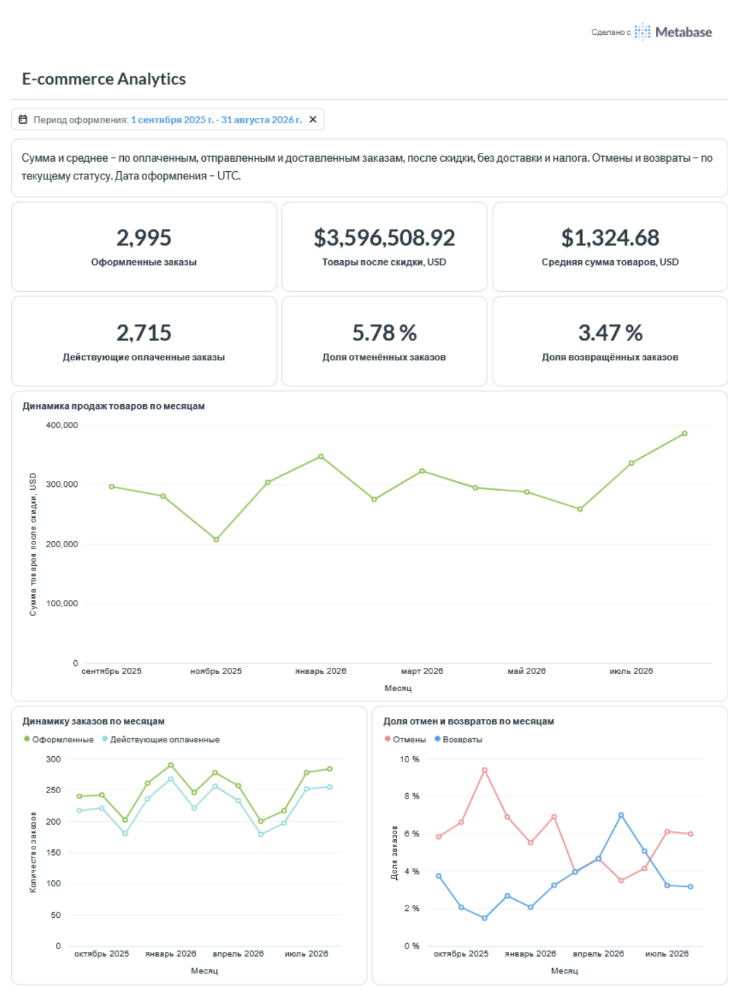
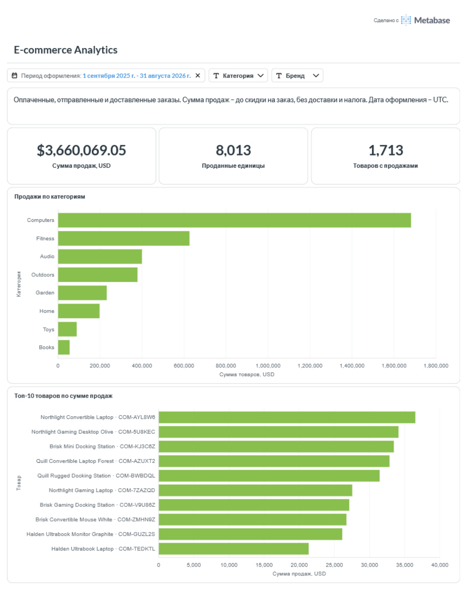
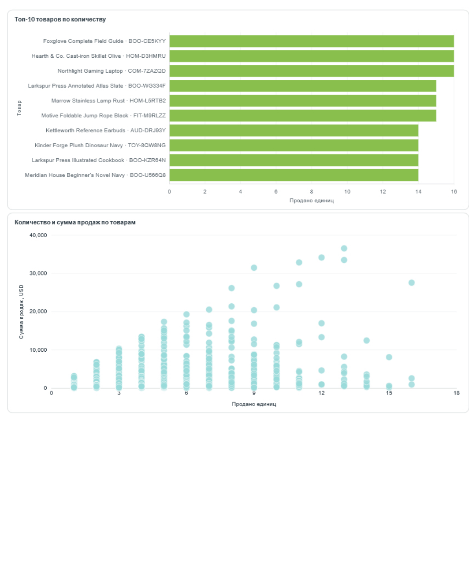
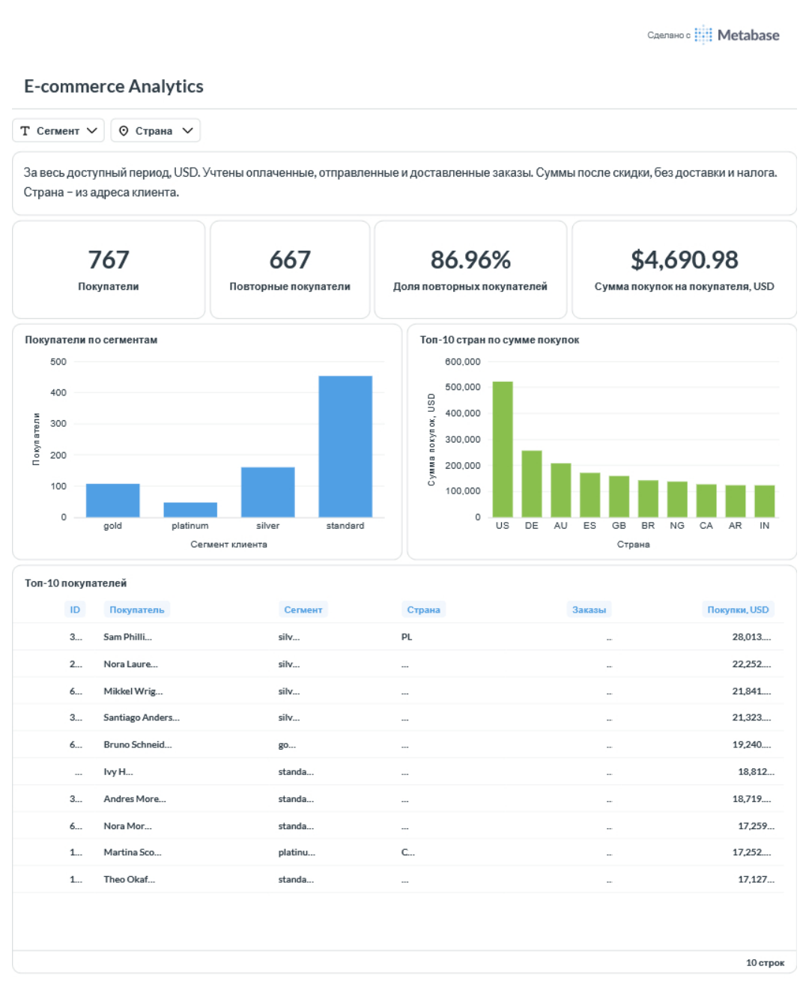

# E-commerce Analytics Platform

Учебный проект аналитики интернет-магазина: загрузка данных из API,
построение хранилища и аналитических витрин, визуализация в Metabase.

## Цель проекта

Подготовить данные и дашборд для анализа трёх направлений:

- Продажи: динамика заказов и суммы продаж, доли отмен и возвратов.
- Товары: вклад категорий и товаров, лидеры по сумме и количеству продаж.
- Клиенты: повторные покупки, сегменты и география покупателей.

## Архитектура

```text
SondaHub Store API
        ↓
Silo — исходные JSON и маркеры успешной выгрузки
        ↓
PostgreSQL / staging — исходные записи в JSONB
        ↓
PostgreSQL / dwh — справочники и фактовые таблицы
        ↓
PostgreSQL / dm — аналитические представления
        ↓
Metabase — дашборд с тремя вкладками
```

Airflow управляет загрузкой от API до DWH и выполняет проверки DWH.
Сервисы запускаются через Docker Compose.

## Стек

- Python: requests, boto3, psycopg2.
- Apache Airflow: оркестрация загрузок.
- Silo: S3-совместимое хранилище исходных файлов.
- PostgreSQL: staging, DWH, аналитические витрины.
- Metabase: визуализация.
- Docker Compose: локальная инфраструктура.

## Данные

Источник — учебный SondaHub Store API.

Объём использованного набора данных:

| Сущность | Количество записей |
|---|---:|
| Категории | 8 |
| Клиенты | 800 |
| Товары | 2 000 |
| Заказы | 3 000 |
| Позиции заказов | 6 219 |

Данные синтетические и не отражают деятельность реального магазина.

## Структура репозитория

```text
dags/                 DAG Airflow
include/              Python-функции загрузки и проверок
sql/                  Создание таблиц, загрузка, витрины и проверки
docs/screenshots/     Скриншоты дашборда
docker-compose.yaml   Конфигурация сервисов
.env.example          Шаблон переменных окружения
```

## Модель DWH

| Таблица | Содержание | Одна строка |
|---|---|---|
| dim_category | Категории | Категория |
| dim_customer | Клиенты | Клиент |
| dim_product | Товары со ссылкой на категорию | Товар |
| fct_order | Заказы со ссылкой на клиента | Заказ |
| fct_order_item | Позиции со ссылками на заказ и товар | Позиция заказа |

Загрузка использует `INSERT ... ON CONFLICT DO UPDATE`:
новые записи добавляются, существующие обновляются по ID.

История изменения атрибутов не сохраняется.
Записи, исчезнувшие из источника, автоматически из DWH не удаляются.

## Аналитические витрины

Витрины реализованы как обычные PostgreSQL VIEW.

| Витрина | Детализация | Назначение |
|---|---|---|
| dm.sales_daily | День оформления и валюта | Продажи и состояние заказов |
| dm.product_performance | День оформления, валюта и товар | Продажи товаров и категорий |
| dm.customer_metrics | Клиент и валюта | Показатели клиентов за весь доступный период |

## Загрузка данных

Основной DAG — `store_pipeline`. Запускается вручную и содержит 12 задач:

1. Выгрузка пяти сущностей из API в Silo.
2. Загрузка пяти сущностей из Silo в staging.
3. Загрузка DWH.
4. Проверки DWH.

Каждый запуск сохраняет исходные файлы в отдельном префиксе с `run_id`.
После записи JSON создаётся маркер `_SUCCESS`.

Все пять исходных выгрузок должны завершиться успешно до начала
загрузки staging. DWH загружается после завершения всех staging-задач.

Staging-таблицы заменяются в отдельных транзакциях.
Загрузка пяти DWH-таблиц выполняется одной транзакцией.
Общей транзакции на весь пайплайн нет: ошибка проверки после загрузки
не откатывает уже обновлённый DWH.

Отдельные DAG `raw_store_ingestion`, `store_to_staging`
и `staging_to_dwh` сохранены для запуска отдельных этапов.
Их не следует запускать одновременно с `store_pipeline`.

## Проверки качества

В SQL-скриптах предусмотрены проверки:

- Заполненности и уникальности ID.
- Связей между сущностями.
- Количества и денежных значений.
- Соответствия суммы позиции количеству и цене.
- Соответствия subtotal сумме позиций заказа.
- Формулы итоговой суммы заказа.
- Количества строк staging и DWH.
- Соответствия показателей витрин данным DWH.

В Airflow автоматически выполняются шесть проверок из
`10_check_dwh.sql`: пять сверок количества строк и одна сверка
subtotal с суммой позиций. При ненулевом количестве ошибок задача падает.

Профилирование staging и сверки витрин выполняются отдельно SQL-скриптами.

## Локальный запуск

Потребуются Docker с Docker Compose, доступ к интернету
и SQL-клиент, например DBeaver.

### Первоначальная настройка

1. Создать `.env` на основе `.env.example`.
   Заменить значения-заглушки паролей и задать `AIRFLOW_JWT_SECRET`.
   Файл `.env` не добавлять в Git.

2. Запустить базы данных и Silo:

   ```bash
   docker compose up -d airflow-db dwh-db silo metabase-db
   ```

3. После готовности баз выполнить миграции Airflow:

   ```bash
   docker compose run --rm airflow-init
   ```

4. Запустить Airflow и Metabase:

   ```bash
   docker compose up -d airflow-api-server airflow-scheduler airflow-dag-processor metabase
   ```

5. Создать пользователя Airflow через CLI:

   ```bash
   docker compose exec airflow-api-server airflow users create \
     --username admin \
     --firstname Admin \
     --lastname User \
     --role Admin \
     --email admin@example.com
   ```

   Команда приведена для Bash. Пароль задать при создании пользователя.

6. Открыть консоль Silo и создать бакет с именем из `S3_BUCKET`.

7. Подключиться к PostgreSQL через SQL-клиент:
   хост `localhost`, порт `5433`.
   База, пользователь и пароль — из `DWH_DB_*` в `.env`.

8. Выполнить `sql/01_staging.sql` и `sql/08_dwh.sql`.

9. В Airflow запустить `store_pipeline`.
   Дождаться успешного завершения всех 12 задач.

10. Создать витрины, последовательно выполнив:

    - `sql/11_sales_daily.sql`
    - `sql/13_product_performance.sql`
    - `sql/15_customer_metrics.sql`

11. Выполнить сверки витрин:

    - `sql/12_check_sales_daily.sql`
    - `sql/14_product_performance.sql`
    - `sql/16_check_customer_metrics.sql`

12. Выполнить `sql/17_metabase_access.sql`.
    Отдельно задать пароль роли `metabase_reader`, не сохраняя его в Git.

13. Пройти первоначальную настройку Metabase и подключить PostgreSQL:
    хост `dwh-db`, порт `5432`, база из `DWH_DB_NAME`,
    пользователь `metabase_reader`.

SQL-скрипт выдачи прав использует имя базы `ecommerce`.
Если имя базы изменено в `.env`, его нужно изменить и в этом скрипте.

### Адреса сервисов

| Сервис | Адрес |
|---|---|
| Airflow | http://localhost:8080 |
| Silo Console | http://localhost:9001 |
| Metabase | http://localhost:3000 |
| PostgreSQL с хостовой машины | localhost:5433 |

### Повторный запуск

```bash
docker compose up -d
```

Для обновления данных запустить `store_pipeline` в Airflow.
Повторно создавать таблицы и витрины не требуется.

Данные сервисов сохраняются в Docker volumes.
Команда `docker compose down` сохраняет volumes,
а `docker compose down -v` удаляет их вместе с данными.

## Дашборд Metabase

### Продажи и состояние заказов

Количество заказов, сумма товаров после скидки, средняя сумма товаров
на заказ, доли отмен и возвратов, динамика по месяцам.



### Товары и категории

Сумма продаж до скидки на заказ, проданные единицы, товары с продажами,
продажи по категориям, топ-10 товаров и соотношение количества
и суммы продаж.





### Клиенты

Покупатели и повторные покупатели, доля повторных покупателей,
средняя сумма покупок на покупателя, сегменты, топ-10 стран и покупателей.



## Правила расчёта и ограничения

- Продажи учитывают заказы со статусами `paid`, `shipped`, `delivered`.
- Доставка и налоги в показатели продаж не входят.
- В продажах по заказам и клиентам суммы рассчитаны после скидки.
- В товарной витрине скидка уровня заказа не распределяется по позициям:
  суммы показаны до этой скидки.
- Даты оформления для дневных и месячных показателей приведены к UTC.
- Отмены и возвраты определяются по текущему статусу и относятся
  к дате оформления заказа, а не к дате отмены или возврата.
- На вкладках продаж и товаров по умолчанию выбран период
  01.09.2025–31.08.2026. Сентябрь 2026 представлен только одним днём.
- Клиентские показатели рассчитаны за весь доступный период.
  Повторный покупатель имеет минимум два действующих оплаченных заказа.
- В использованном наборе данных одна валюта — USD.
- Дашборд и сохранённые вопросы хранятся в базе Metabase.
  Репозиторий содержит скриншоты, но не автоматическое развёртывание
  визуализаций. При установке с нуля их нужно создать вручную.

  ## Выводы по дашборду

1. За период 01.09.2025–31.08.2026 оформлено 2 995 заказов.
   Из них 2 715 находятся в статусах paid, shipped или delivered.
   Сумма товаров после скидки составила $3 596 508,92,
   средняя сумма товаров на такой заказ — $1 324,68.

2. Месячные продажи колебались: минимум наблюдается в ноябре 2025,
   максимум — в августе 2026. Устойчивого роста на всём интервале нет.
   Одного года учебных данных недостаточно для вывода о сезонности.

3. Computers лидирует среди категорий по сумме продаж до скидки
   на заказ. При этом лидеры по количеству проданных единиц относятся
   к разным категориям. Рейтинг по сумме продаж отличается от рейтинга
   по количеству: для оценки товаров нужны оба показателя.

4. На конец наблюдения доля отменённых заказов за выбранный период
   составляет 5,78%, возвращённых — 3,47%.
   Это текущие статусы заказов, сгруппированных по дате оформления,
   а не количество событий отмены и возврата за месяц.

5. За весь доступный период покупки совершили 767 клиентов.
   Из них 667 имеют минимум два действующих оплаченных заказа —
   86,96% покупателей. Средняя сумма покупок на покупателя
   составила $4 690,98. Эта доля характеризует повторные покупки
   в наборе данных и не является показателем удержания.

